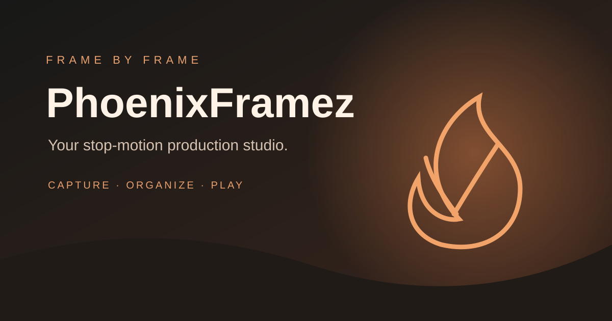

# PhoenixFramez

**A browser-based stop-motion production studio.** Capture stills, build a frame library, compare exposures with onion skin, and play your animation at a chosen frame rate.

[Open the live studio](https://wonka15.github.io/Phoenix-Framez/) · [Source code](https://github.com/Wonka15/Phoenix-Framez/tree/ndev)



## Try it

1. Open the live studio over HTTPS.
2. Choose **Load demo project** to explore without a camera.
3. Open **Camera station**, allow camera access, and capture a few stills (or import images).
4. Select exposures in the frame library and play them at 12, 15, 24, 25 or 30 FPS.
5. Export a portable JSON project, a ZIP image sequence, or a WebM recording when supported by the browser.

## Current features

- Browser camera capture with explicit permission and camera-off controls.
- Import still images, reorder/select exposures, copy/paste/delete and blank frames.
- Onion-skin comparison, composition guides and a frame-rate playback timeline.
- IndexedDB-backed frame storage, with migration from older local browser storage.
- JSON project export/import (image data is embedded in the project file).
- ZIP image-sequence export and browser-supported WebM movie export.
- Demo animation, drawing/reference overlays, lip-sync cue sheet and keyboard help.
- Responsive studio layout with touch-friendly capture controls.

## Known limitations (alpha)

- **MP4 and GIF export are not implemented.** WebM is available only where MediaRecorder and canvas capture are supported. ZIP image sequences are the most portable export.
- Browser storage can be cleared by the user or browser. Export project backups regularly.
- Large projects may use substantial browser storage and memory; image imports are resized for more practical use.
- Camera support depends on HTTPS, browser permissions, device drivers and camera capabilities. Manual ISO, shutter, focus and white balance are not universal.
- Front/back camera selection is offered on mobile; some browsers may expose only a single camera choice.
- Drawing and reference layers are browser-side project data; advanced compositing and audio-mixed movie rendering are not included.
- Blender, Godot, Eagle Animation, Audacity and Toucan Camera Server connections are roadmap items, not active bidirectional integrations.
- The live site is an alpha and still needs broad testing across iOS Safari, Android Chrome and desktop browsers.

## Local development

This is a static site using native browser ES modules. Serve the repository over localhost (camera APIs require a secure context):

```bash
npm install
npm run check
npm run build
```

Then serve the repository or the generated `dist/` folder with a local static HTTP server.

## Branches and releases

- `main` — stable release branch.
- `ndev` — active development branch.

Changes are developed and checked on `ndev`. Promote to `main` only after the core capture, storage, playback, import and export workflow passes browser testing.

## License

MIT. See [LICENSE](LICENSE).
